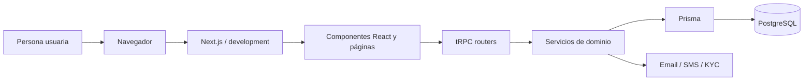
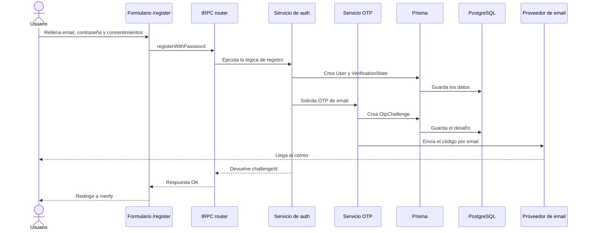

# Arquitectura de Toolyo

Guía pensada para entender el proyecto desde cero. La idea es responder a tres preguntas simples:

1. Qué piezas tiene la aplicación.
2. Cómo viaja una petición desde el navegador hasta la base de datos.
3. Dónde mirar cuando algo falla.

---

## 1. Mapa general

Piensa en Toolyo como una cadena de trabajo:

```text
Persona -> Navegador -> Next.js -> tRPC -> Servicios -> Prisma -> PostgreSQL
                                 -> Proveedores externos (email, SMS, KYC)
```

Y en forma visual:



La idea clave es esta:
- El navegador solo muestra pantallas y envía formularios.
- Next.js decide qué página enseñar.
- tRPC transporta datos entre frontend y backend.
- Los servicios hacen el trabajo importante.
- Prisma habla con PostgreSQL.
- Los proveedores externos envían correos, SMS o verifican identidad.

---

## 2. Las piezas del proyecto

### 2.1 Frontend

Está en `development/src/app` y `development/src/components`.

- `src/app` contiene las páginas.
- `src/components/forms` contiene los formularios interactivos.
- `src/styles/globals.css` define el aspecto visual.

Qué hace esta parte:
- Muestra pantallas como `/register`, `/verify` y `/kyc`.
- Recoge datos del usuario.
- Enseña mensajes de error y confirmación.
- No debería contener lógica de negocio compleja.

### 2.2 Backend

Está en `development/src/server`.

- `src/server/api/routers` expone operaciones tRPC.
- `src/server/auth` contiene la lógica del registro, OTP y onboarding.
- `src/server/integrations` adapta email, SMS, KYC y otras herramientas externas.
- `src/server/lib` agrupa errores, logs y utilidades.

Qué hace esta parte:
- Valida reglas importantes.
- Crea usuarios.
- Genera códigos OTP.
- Guarda estados en base de datos.
- Conecta con servicios externos sin mezclar detalles de proveedor en el resto del código.

### 2.3 Base de datos

Está definida en `development/prisma/schema.prisma`.

Las tablas principales del registro son:

- `User`
- `PasswordCredential`
- `VerificationState`
- `OtpChallenge`
- `LegalDocument`
- `LegalAcceptance`
- `IdentityVerification`
- `SecurityEvent`

Piensa en PostgreSQL como la memoria de largo plazo del sistema.

### 2.4 Proveedores externos

Están detrás de adaptadores para no acoplar el proyecto a un solo servicio.

- Email para códigos OTP.
- SMS para códigos OTP.
- KYC para verificación de identidad.

La app puede cambiar de proveedor sin reescribir toda la lógica de negocio.

---

## 3. Cómo funciona un registro

Este es el flujo más importante del proyecto porque toca casi todas las capas.



Versión en palabras:

1. La persona rellena el formulario.
2. El frontend manda los datos al backend.
3. El backend crea el usuario.
4. Luego crea un código de verificación.
5. El código se guarda solo como hash, no en claro.
6. El proveedor externo envía el correo.
7. La pantalla de verificación usa el `challengeId` para validar el código.

---

## 4. Boceto de capas

```text
+--------------------------------------------------------------+
|                           UI                                 |
|  Páginas + formularios + estilos                             |
|  src/app / src/components / src/styles                       |
+------------------------------+-------------------------------+
                               |
                               v
+--------------------------------------------------------------+
|                        CONTRATO                              |
|  tRPC routers + schemas Zod                                   |
|  src/server/api/routers                                       |
+------------------------------+-------------------------------+
                               |
                               v
+--------------------------------------------------------------+
|                          NEGOCIO                             |
|  auth, OTP, KYC, consentimientos, capacidades                |
|  src/server/auth                                             |
+------------------------------+-------------------------------+
                               |
                               v
+--------------------------------------------------------------+
|                         PERSISTENCIA                         |
|  Prisma + PostgreSQL                                          |
|  development/prisma / database                                |
+------------------------------+-------------------------------+
                               |
                               v
+--------------------------------------------------------------+
|                     SERVICIOS EXTERNOS                       |
|  Email, SMS, KYC                                              |
|  src/server/integrations                                      |
+--------------------------------------------------------------+
```

Regla fácil de recordar:
- La UI pregunta.
- El contrato valida.
- El negocio decide.
- La base guarda.
- Los proveedores envían o verifican cosas fuera de la app.

---

## 5. Qué hace cada carpeta

### `development/src/app`
Páginas y layouts.

### `development/src/components`
Componentes reutilizables, sobre todo formularios.

### `development/src/server/api`
Punto de entrada tRPC.

### `development/src/server/auth`
Lógica de registro, OTP, verificación y estado de onboarding.

### `development/src/server/integrations`
Adaptadores para email, SMS, KYC y otras APIs externas.

### `development/src/lib`
Utilidades compartidas y contratos comunes.

### `development/prisma`
Esquema y migraciones de base de datos.

### `development/tests`
Pruebas unitarias e integración.

---

## 6. Piezas importantes explicadas fácil

### Next.js
Es el marco que sirve la web. También decide qué página se renderiza.

### tRPC
Es la autopista entre frontend y backend. Permite llamar funciones del servidor desde el cliente con tipado compartido.

### Zod
Es el guardia de seguridad de entrada. Evita que lleguen datos mal formados.

### Prisma
Es la herramienta que traduce código a SQL para hablar con PostgreSQL.

### PostgreSQL
Es donde viven los datos reales: usuarios, verificaciones, documentos y auditoría.

### OTP
Es el código temporal que se manda por email o SMS para comprobar que la persona controla ese canal.

### KYC
Es la verificación de identidad. En este proyecto se trata como un flujo separado y opcional.

### Adaptadores externos
Son la capa que habla con servicios de fuera. Si cambias de proveedor, el resto del sistema no debería enterarse demasiado.

---

## 7. Flujo de datos del registro

```mermaid
flowchart TD
  A[Persona abre /register] --> B[Completa formulario]
  B --> C[Formulario cliente valida lo básico]
  C --> D[tRPC recibe la petición]
  D --> E[Servicio auth normaliza y valida]
  E --> F[Prisma guarda User y consentimientos]
  F --> G[Servicio OTP genera desafío]
  G --> H[Proveedor de email envía el correo]
  H --> I[Usuario recibe código]
  I --> J[/verify valida el OTP]
  J --> K[Estado pasa a verified]
```

---

## 8. Qué mirar cuando algo falla

### Si falla el frontend
Mira:
- `src/app`
- `src/components/forms`
- la consola del navegador
- la pestaña `Network`

### Si falla el backend
Mira:
- `src/server/api/routers`
- `src/server/auth`
- los logs del terminal donde corre `npm run dev`

### Si falla la base de datos
Mira:
- migraciones en `development/prisma/migrations`
- `docker compose -f development/docker-compose.yml up -d`
- `docker logs toolyo_postgres`

### Si falla el envío de email o SMS
Mira:
- `src/server/integrations/email`
- `src/server/integrations/sms`
- variables de entorno en `.env`

---

## 9. Cómo encajar todo en tu cabeza

Una forma simple de pensar el sistema es esta:

- La interfaz recoge la intención de la persona.
- El backend decide si esa intención es válida.
- La base de datos recuerda lo que ya pasó.
- Los proveedores externos hacen tareas especializadas.

Si quieres una frase todavía más corta:

**Pantalla -> Validación -> Lógica -> Guardado -> Envío**

---

## 10. Ruta recomendada para un principiante

Si estás empezando, te conviene leer el proyecto en este orden:

1. `development/README.md`
2. `development/CHEATSHEET.md`
3. `development/src/app/(auth)/register/page.tsx`
4. `development/src/components/forms/registration-form.tsx`
5. `development/src/server/api/routers/auth.router.ts`
6. `development/src/server/auth/auth.service.ts`
7. `development/prisma/schema.prisma`

---

## 11. Idea final

Toolyo está organizado para que la interfaz sea fina, la lógica importante viva en el servidor y la base de datos sea la fuente de verdad. Si entiendes ese triángulo, entiendes casi todo el proyecto.
