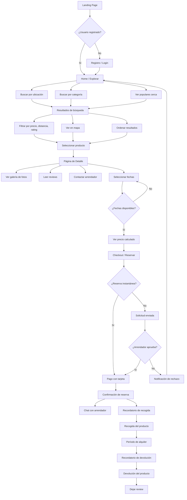
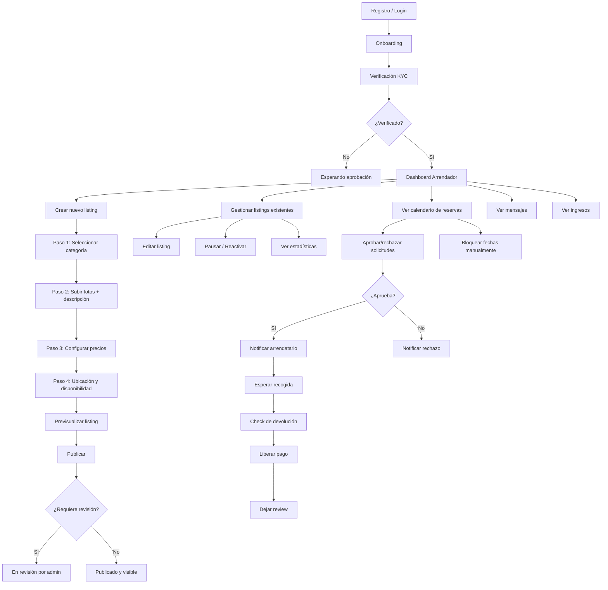
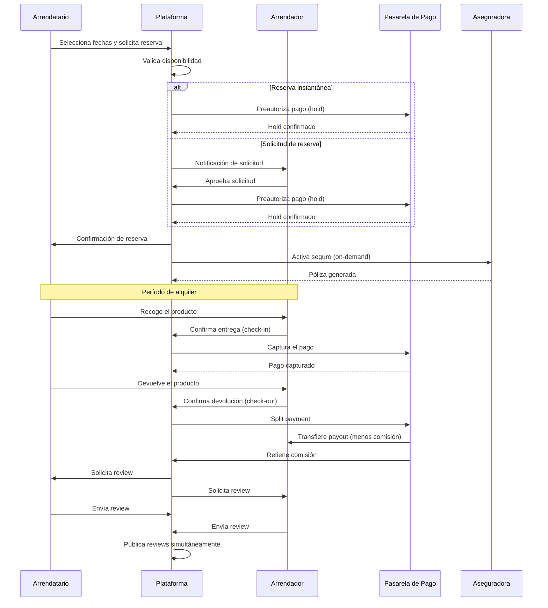
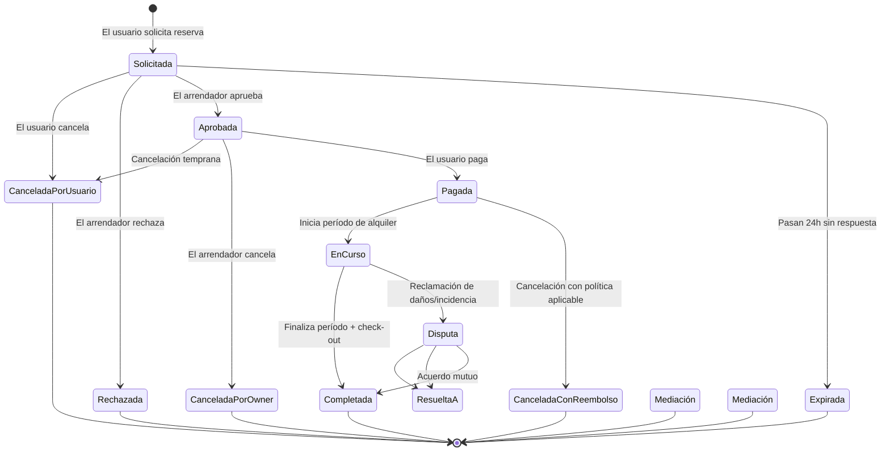
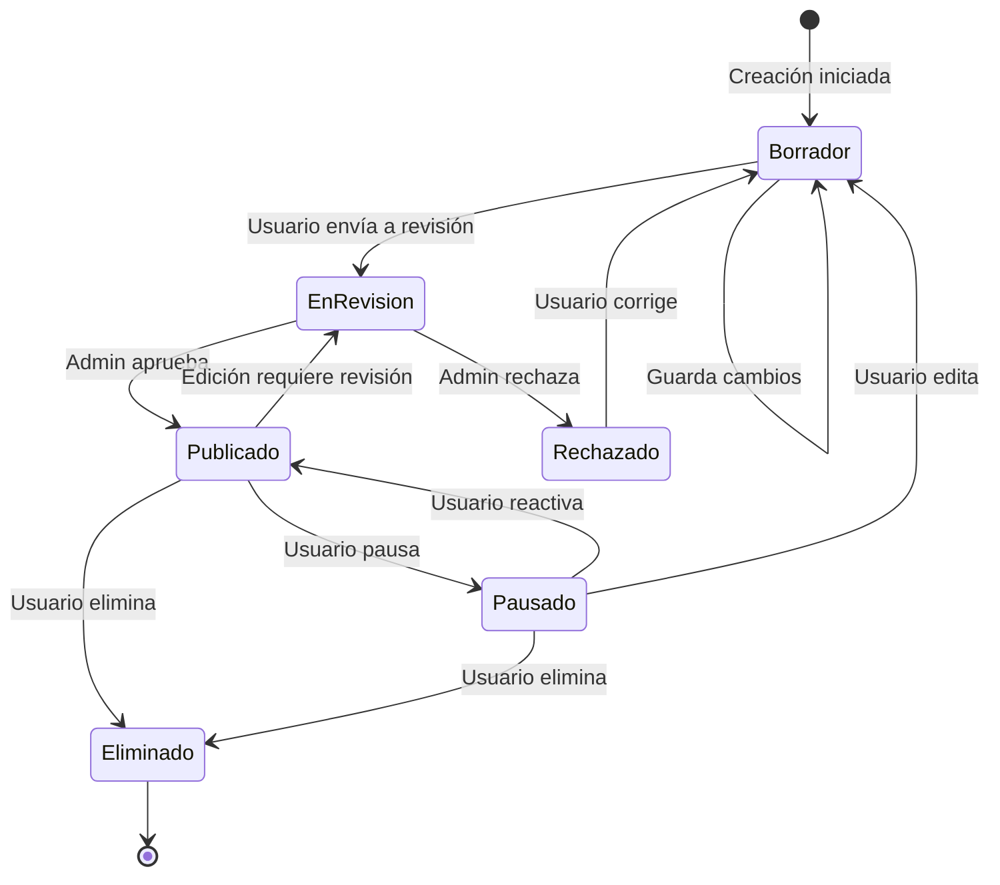
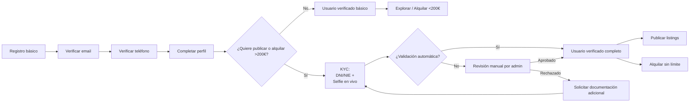
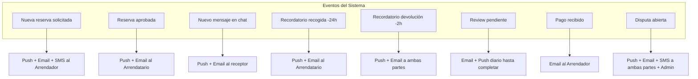

# Diagramas de Navegación y Flujos de Usuario

## 1. Arquitectura de Información (Site Map)

```
┌─────────────────────────────────────────────────────────────────────────────┐
│                              HYGGLO ESPAÑA                                  │
│                         Mapa de Navegación                                  │
└─────────────────────────────────────────────────────────────────────────────┘

┌──────────────┐
│   LANDING    │
│   (Página    │
│   Principal) │
└──────┬───────┘
       │
       ├─────────────────┬─────────────────┬─────────────────┬───────────────┐
       │                 │                 │                 │               │
       ▼                 ▼                 ▼                 ▼               ▼
┌──────────────┐ ┌──────────────┐ ┌──────────────┐ ┌──────────────┐ ┌──────────────┐
│   EXPLORAR   │ │   CÓMO       │ │   PUBLICAR   │ │    AYUDA     │ │   MI CUENTA  │
│  (Búsqueda)  │ │  FUNCIONA    │ │   (Arrendar) │ │   (FAQ/      │ │   (Auth)     │
│              │ │              │ │              │ │   Contacto)  │ │              │
└──────┬───────┘ └──────────────┘ └──────┬───────┘ └──────────────┘ └──────┬───────┘
       │                                 │                                 │
       │         ┌───────────────────────┘                                 │
       │         │                                                         │
       ▼         ▼                                                         ▼
┌──────────────┐ ┌────────────────────────────────────────────┐  ┌──────────────────┐
│  RESULTADOS  │ │          DASHBOARD ARRENDADOR              │  │   PERFIL USER    │
│   (Grid +    │ │  ┌──────────┐ ┌──────────┐ ┌──────────┐  │  │  ┌────────────┐  │
│    Mapa)     │ │  │ Mis      │ │ Calen-   │ │ Mensajes │  │  │  │ Mis datos  │  │
│              │ │  │ Listings │ │ dario    │ │          │  │  │  │ Preferencias│  │
└──────┬───────┘ │  └──────────┘ └──────────┘ └──────────┘  │  │  │ Pagos      │  │
       │         │  ┌──────────┐ ┌──────────┐ ┌──────────┐  │  │  │ Notificac. │  │
       │         │  │ Ingresos │ │ Reservas │ │ Ajustes  │  │  │  └────────────┘  │
       │         │  └──────────┘ └──────────┘ └──────────┘  │  └──────────────────┘
       │         └────────────────────────────────────────────┘
       │
       ▼
┌──────────────┐
│   DETALLE    │
│   PRODUCTO   │
│  (Galería,   │
│   Precios,   │
│   Reviews)   │
└──────┬───────┘
       │
       ├─────────────┬─────────────┐
       │             │             │
       ▼             ▼             ▼
┌──────────────┐ ┌──────────────┐ ┌──────────────┐
│    CHAT      │ │   CHECKOUT   │ │  PERFIL      │
│  (Con owner) │ │  (Reserva +  │ │  ARRENDADOR  │
│              │ │   Pago)      │ │              │
└──────────────┘ └──────┬───────┘ └──────────────┘
                        │
                        ▼
               ┌────────────────┐
               │  CONFIRMACIÓN  │
               │   DE RESERVA   │
               └────────────────┘
```

---

## 2. Flujo de Navegación del Arrendatario (Quien Alquila)



---

## 3. Flujo de Navegación del Arrendador (Quien Publica)



---

## 4. Flujo de Transacción y Pagos



---

## 5. Diagrama de Estados de una Reserva



---

## 6. Diagrama de Estados de un Listing



---

## 7. Flujo de Onboarding y KYC



---

## 8. Wireframes de Navegación por Pantalla

### 8.1 Estructura de la Landing Page
```
┌────────────────────────────────────────────┐
│  [Logo]    [Buscar]    [Publicar] [Login]  │  ← Header fijo
├────────────────────────────────────────────┤
│                                            │
│         HERO: "Alquila en lugar de         │
│              comprar"                      │
│                                            │
│   [¿Qué necesitas?] [¿Dónde?] [Buscar]   │
│                                            │
├────────────────────────────────────────────┤
│  CATEGORÍAS POPULARES:                     │
│  [🔧] [🚲] [⛺] [🎉] [📷] [🚗]           │
│  Herramientas Bicis Camping Fiesta Fotos   │
├────────────────────────────────────────────┤
│  POPULARES CERCA DE TI:                    │
│  ┌─────┐ ┌─────┐ ┌─────┐ ┌─────┐         │
│  │IMG  │ │IMG  │ │IMG  │ │IMG  │         │
│  │Talad│ │Remol│ │Tiend│ │Sonid│         │
│  │50€/d│ │30€/d│ │25€/d│ │40€/d│         │
│  └─────┘ └─────┘ └─────┘ └─────┘         │
├────────────────────────────────────────────┤
│  CÓMO FUNCIONA:                            │
│  1. Busca → 2. Reserva → 3. Recoge →      │
│     4. Devuelve                            │
├────────────────────────────────────────────┤
│  [Footer: Sobre nosotros, Ayuda, Legal]    │
└────────────────────────────────────────────┘
```

### 8.2 Estructura de Página de Detalle
```
┌────────────────────────────────────────────┐
│  [Logo]    [Buscar]    [Publicar] [Login]  │
├────────────────────────────────────────────┤
│  [IMG Principal] [Thumb] [Thumb] [Thumb]   │
├────────────────────────────────────────────┤
│  Nombre del producto              [♥]      │
│  ⭐ 4.8 (23 reviews)    📍 A 2.3 km        │
│                                            │
│  Descripción del producto...               │
│  Ver más                                   │
├────────────────────────────────────────────┤
│  📅 CALENDARIO DE DISPONIBILIDAD           │
│  [Jun] [Jul] [Ago] ...                   │
│  [1][2][3][4]... seleccionar fechas      │
├────────────────────────────────────────────┤
│  💰 PRECIOS:                               │
│  1 día: 50€/día  |  3 días: 40€/día      │
│  7 días: 30€/día  |  +7 días: a consultar │
├────────────────────────────────────────────┤
│  👤 ARRENDADOR:                            │
│  [Foto] María · ⭐ 5.0 · Respuesta <1h    │
│  [Ver perfil] [Contactar]                  │
├────────────────────────────────────────────┤
│  🛡️ SEGURO: Cubierto sin franquicia        │
├────────────────────────────────────────────┤
│  💬 REVIEWS (23):                          │
│  ⭐⭐⭐⭐⭐ "Todo perfecto, muy amable"      │
│  ⭐⭐⭐⭐⭐ "El producto estaba impecable"    │
├────────────────────────────────────────────┤
│  [        RESERVAR AHORA — 120€           ]│
│         (2 días × 50€ + comisión)          │
└────────────────────────────────────────────┘
```

### 8.3 Estructura del Dashboard Arrendador
```
┌────────────────────────────────────────────┐
│  [Logo]    [Buscar]    [Publicar] [Avatar▼]│
├────────────────┬───────────────────────────┤
│  MENÚ          │  CONTENIDO PRINCIPAL      │
│  ───────────── │                           │
│  📋 Mis anuncios                           │
│  📅 Calendario                             │
│  💬 Mensajes (3)                           │
│  📦 Reservas    →  [Tabla de reservas]     │
│  💶 Ingresos    →  [Gráfico + historial]   │
│  ⚙️ Ajustes                                │
│  🆘 Ayuda                                  │
├────────────────┴───────────────────────────┤
│  [Footer]                                  │
└────────────────────────────────────────────┘
```

---

## 9. Flujo de Notificaciones Push/Email


